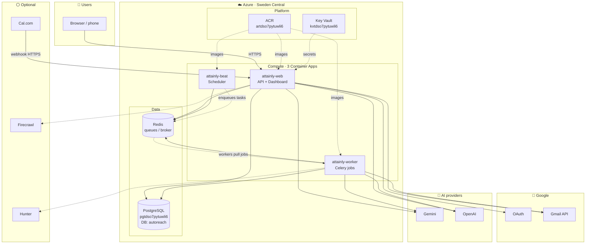
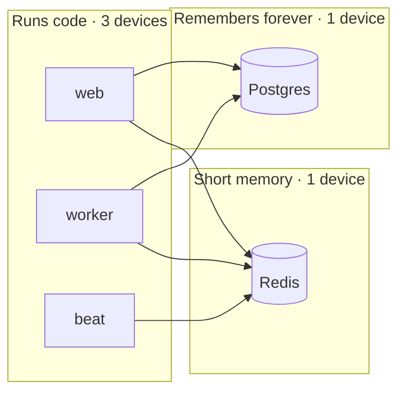
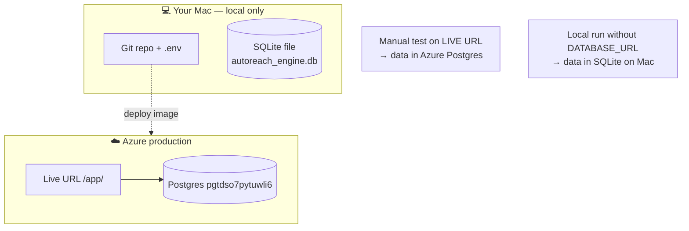

# Attainly — Pictorial architecture (devices & connections)

How many boxes exist in production, and how they talk to each other.

**Live region:** Azure · Sweden Central · `attainly-prod-swedencentral-rg`

---

## 1. Device inventory (count)

| # | Device / service | Type | What it is |
|---|------------------|------|------------|
| 1 | **Your browser** | Client | Opens the product UI |
| 2 | **attainly-web** | Azure Container App | FastAPI + React `/app/` |
| 3 | **attainly-worker** | Azure Container App | Celery workers (send, poll, jobs) |
| 4 | **attainly-beat** | Azure Container App | Celery scheduler (ticks) |
| 5 | **PostgreSQL** `pgtdso7pytuwli6` | Azure DB | Main database (`autoreach`) |
| 6 | **Redis** | Cache / queue | Celery broker (URL in secrets) |
| 7 | **ACR** `artdso7pytuwli6` | Container registry | Stores Docker images |
| 8 | **Key Vault** `kvtdso7pytuwli6` | Secrets (optional store) | Related secrets infra |
| 9 | **Gmail API** | External | Send / receive email |
| 10 | **Google OAuth** | External | Login mailbox connect |
| 11 | **Gemini / OpenAI** | External | AI drafts / classify |
| 12 | **Firecrawl** *(optional)* | External | Page scrape for leads |
| 13 | **Hunter** *(optional)* | External | Email enrichment |
| 14 | **Cal.com** *(optional)* | External | Booking webhooks |

**Inside Azure (always-on stack):** 3 apps + 1 Postgres + 1 Redis + ACR (+ Key Vault) ≈ **6–7 cloud devices**.  
**Outside Azure:** browser + Google/Gmail + AI (+ optional Firecrawl/Hunter/Cal).

Your **laptop** is separate: only used for code/`.env`/local SQLite — **not** in the production path when you use the live URL.

---

## 2. Big picture — who connects to whom



---

## 3. Same map as a simple wiring list

```
Browser
   │  HTTPS
   ▼
attainly-web  ──────┬──────────►  PostgreSQL  (campaigns, contacts, mailboxes, jobs…)
   │                │
   │                └──────────►  Redis       (job queues)
   │
   ├──► Gmail / Google OAuth
   ├──► Gemini / OpenAI
   └──► Cal.com webhooks (inbound)

attainly-beat
   └──► Redis  (puts scheduled work on queues)

attainly-worker
   ├──► Redis  (reads queues)
   ├──► PostgreSQL
   └──► Gmail / LLM / Hunter…
```

---

## 4. What each connection carries

| From → To | Protocol | Purpose |
|-----------|----------|---------|
| Browser → web | HTTPS | UI + REST API + JWT login |
| Web → Postgres | PostgreSQL/TLS | Read/write all business data |
| Web → Redis | Redis/TLS | Enqueue work; readiness probes |
| Beat → Redis | Redis/TLS | Schedule `tick` / signal ingest |
| Worker → Redis | Redis/TLS | Consume queues |
| Worker → Postgres | PostgreSQL/TLS | Update jobs, replies, costs |
| Web/Worker → Gmail | HTTPS | OAuth + send + poll |
| Web/Worker → LLM | HTTPS | Draft / classify |
| Cal.com → Web | HTTPS webhook | Booking events |
| ACR → Apps | Image pull | Deploy new versions |

---

## 5. Data vs compute (one glance)



- **Postgres** = campaigns, contacts, users, mailboxes, sends, replies  
- **Redis** = “do this job next” (not your customer list)  
- **3 Container Apps** = the only places code runs in prod  

---

## 6. Local laptop vs Azure (do not confuse)



---

## 7. One-sentence summary

**3 app containers + 1 Postgres + 1 Redis** in Azure, reached by your **browser**, talking out to **Gmail / Google / AI** (and optional Firecrawl, Hunter, Cal.com).

---

*See also: [HLD_ATTAINLY.md](./HLD_ATTAINLY.md) for full design text.*
