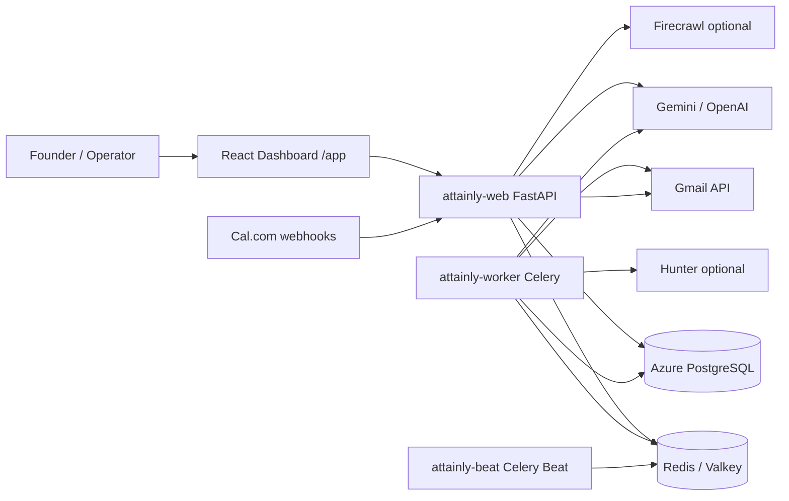
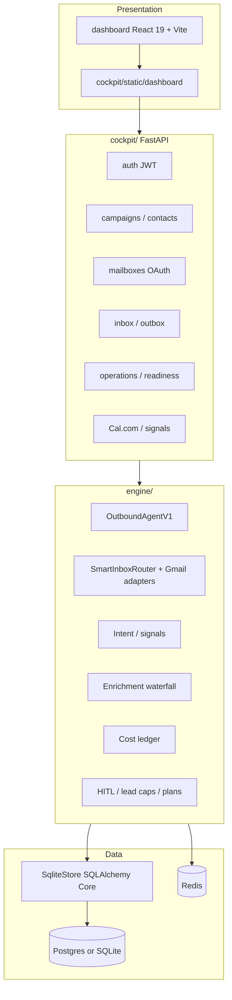
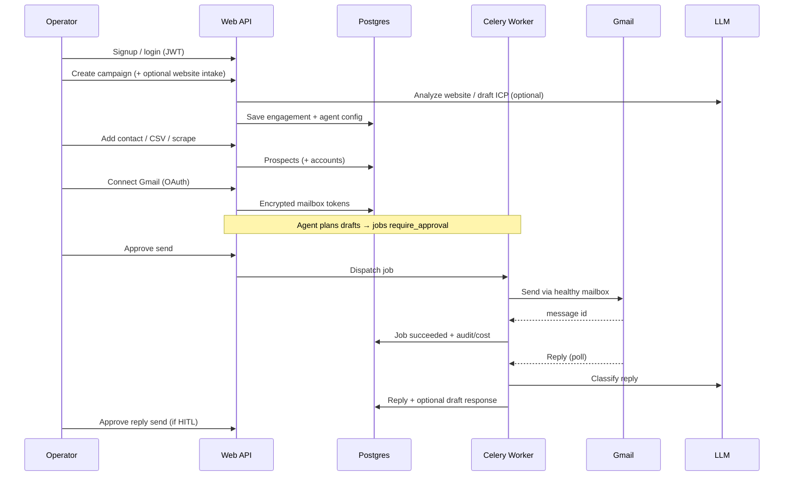

# Attainly — High-Level Design (HLD)

**Status:** Living architecture doc (verified against code + Azure Sweden Central deploy)  
**Product thesis:** Signal-driven AI revenue execution — tenant-safe, human-approved outbound with deliverability controls and cost/ROI ledger.  
**Internal infra name:** AutoReach (`AUTOREACH_*`). **On-screen brand:** Attainlly / Attainly.

This is a design of **what is built**, not a pitch for what is fully proven with customers.

---

## 1. Purpose

Attainly helps a B2B team:

1. Configure a campaign from business context (website-assisted ICP / offer / signals).
2. Bring in prospects (manual, CSV, scrape when Firecrawl is configured, signals).
3. Draft outreach with AI; keep risky sends behind human approval (HITL).
4. Send through healthy, connected Gmail mailboxes (smart router).
5. Detect replies, classify, optionally draft responses under approval.
6. Record cost and outcomes for ROI proof.

**Moat is trust:** tenant isolation, HITL, deliverability-aware dispatch, auditability — not “AI writes email.”

---

## 2. System context

**Actors**

| Actor | Role |
|-------|------|
| Founder / operator | Signup, configure campaigns, approve sends, connect mailbox |
| Tenant | Isolated workspace; all data scoped by `tenant_id` |
| Background workers | Plan jobs, dispatch email, poll replies, ingest signals |
| External providers | Gmail, LLM, Firecrawl, Hunter, Cal.com |

---

## 3. Deployment topology (production)

**Cloud:** Azure  
**Resource group:** `attainly-prod-swedencentral-rg` (Sweden Central)

| Component | Azure resource | Responsibility |
|-----------|----------------|----------------|
| Web API + SPA | Container App `attainly-web` | REST + JWT auth + static `/app/` |
| Worker | Container App `attainly-worker` | Celery queues: `engine`, `maintenance`, `standard-agents` |
| Scheduler | Container App `attainly-beat` | Periodic ticks / signal ingest (exactly one beat) |
| System of record | PostgreSQL Flexible Server `pgtdso7pytuwli6` DB `autoreach` | All durable business state |
| Broker / short cache | Redis (URL via secret `redis-url`) | Celery broker, ephemeral counters |
| Secrets | Container App secrets (+ Key Vault present) | JWT, Fernet, DB URL, OAuth, Gemini, etc. |
| Images | ACR `artdso7pytuwli6` | App container images |

**Public URL (current):**  
`https://attainly-web.ashymeadow-644c5a42.swedencentral.azurecontainerapps.io`

**Local laptop (dev):** typically SQLite `autoreach_engine.db` if `DATABASE_URL` unset — **not** the same data as Azure.

---

## 4. Logical architecture

| Layer | Path | Notes |
|-------|------|-------|
| UI | `dashboard/src/` → built into `cockpit/static/dashboard/` | Served at `/app/` |
| API | `cockpit/api/*` | Tenant from JWT, not spoofable headers |
| Domain / runtime | `engine/` | Agents, dispatch, storage, workers |
| Workers | `engine/worker/celery_app.py`, `engine/tasks.py` | Idempotent, tenant-scoped tasks |

---

## 5. Core revenue graph (happy path)

---

## 6. Data design (system of record)

**Store:** SQLAlchemy Core schema in `engine/storage/sqlite.py` (works on SQLite + Postgres).

| Table (concept) | Contents |
|-----------------|----------|
| `tenants` / `users` | Multi-tenant identity |
| `engagements` | Campaigns (client cure, signal matrix, budgets) |
| `prospects` | Contacts / leads |
| `accounts` | Company/domain grouping |
| `agents` | Runner config (HITL threshold, templates) |
| `jobs` | Outbound / follow-up work items + state |
| `mailboxes` | Connected senders (encrypted creds) |
| `replies` / `meetings` | Conversation outcomes |
| `events` | Audit / domain events |
| `cost_entries` | COGS / ledger |
| `signal_*` | Sources, events, connectors, ingestion |
| `mcp_audit_events` | MCP tool audit |

**Invariant:** every customer-facing row is filtered by `tenant_id`.

**Ephemeral (Redis):** Celery queues, short-lived health/rate counters — not the source of truth for campaigns/contacts.

---

## 7. Key subsystems

### 7.1 Auth & tenancy
- JWT access + refresh (`engine/auth`)
- Tenant resolved from signed token
- Plan limits (campaigns, leads, personalization)

### 7.2 Campaign & discovery
- Website intake → editable ICP / templates (`/api/onboarding/analyze-website`)
- Contacts: manual, CSV, scrape (`FIRECRAWL_API_KEY` required for scrape)
- People discovery / Hunter enrichment: optional, config-gated
- Launch checklist requires ≥1 contactable (email) prospect

### 7.3 HITL & deliverability
- Jobs may require approval; trust ramp exists (auto-send after threshold unless risk)
- Deliverability guardian can force approval
- Smart inbox router: mailbox health, caps, ESP preference, fail-safe

### 7.4 Gmail
- BYOC / env OAuth (`GOOGLE_CLIENT_ID` / `SECRET`)
- Tokens encrypted at rest (`AUTOREACH_CREDENTIAL_ENCRYPTION_KEY`)
- Dry-run flag: `AUTOREACH_GMAIL_DRY_RUN` (production should be `0` only after mailbox proof)

### 7.5 Signals
- Matrix fail-closed; RSS / webhook / manual connectors
- Beat schedules connector ingest

### 7.6 Learning & CRM
- Learning: **advisory** measurement (not autonomous self-learning)
- CRM via MCP: contract / stdio tools — **not** a live CRM product path for pilot v0

### 7.7 Readiness
- `/healthz` — process alive  
- `/readyz` / `/readyz?deep=true` — secrets + DB/Redis + Celery queue inspect  

---

## 8. Security design (product features)

| Control | Mechanism |
|---------|-----------|
| Tenant isolation | JWT + `WHERE tenant_id=` everywhere |
| Secrets | Azure secret refs; fail closed on placeholders |
| Mailbox creds | Fernet encrypt at rest |
| Webhooks | HMAC + production fail-closed (Cal.com) |
| Legacy console | Off for non-SQLite / production |
| Rate limits | Auth endpoints (per-IP) |
| HITL | External sends gated by policy |

---

## 9. Environments

| Env | API host | DB | Use |
|-----|----------|-----|-----|
| Local | localhost | SQLite (default) or local Postgres | Dev / unit tests |
| Production | Azure Container App FQDN | Azure Postgres `autoreach` | Pilots / demos |

**Rule:** UI actions on the Azure URL write to **Azure Postgres**. Local SQLite does not see that data.

---

## 10. External dependencies

| Dependency | Required for pilot? | Notes |
|------------|---------------------|-------|
| Azure Postgres + Redis | Yes | Core |
| Gemini and/or OpenAI | Yes for AI drafts | Readiness requires Gemini key today |
| Google OAuth + Gmail | Yes for live send | Controlled mailbox |
| Cal.com webhook secret | Yes for `/readyz` | Booking path |
| Firecrawl | No for manual pilot | Needed for URL lead scrape |
| Hunter | No | Enrichment when keyed |
| Phoenix / Sentry / Razorpay | No | Optional observability / billing |

---

## 11. Non-goals / honesty boundaries

- Not “paste website → finds entire market automatically” without providers + data.
- Not autonomous send-everything / books meetings while you sleep.
- Not proven at deliverability scale or with paying customers yet.
- Clearbit/Apollo remain stubs; do not market as live providers.
- CRM sync is not a production pilot dependency.

---

## 12. Pilot acceptance (design-level)

A controlled pilot is “architecturally complete” when:

1. Azure web + worker + beat healthy; deep `/readyz` ok.  
2. Tenant can create campaign + contactable prospect.  
3. Gmail connected; approve → real send with provider message id.  
4. Reply appears and can be acted on under HITL.  
5. Costs/outcomes visible without fake numbers.  
6. Marketing claims match this HLD.

---

## 13. Related docs

- `docs/CAPABILITY_MATRIX.md` — feature honesty matrix  
- `docs/PRODUCTION_SECRETS_CHECKLIST.md` — secret activation  
- `docs/FINAL_MASTER_LOOP_VERDICT.md` — pilot GO/NO-GO history  
- `infra/main.bicep` — Azure resource definitions  
- `CLAUDE.md` — operating charter / invariants  

---

*End of HLD. Update this file when topology (hostname, RG, DB server) or core invariants change.*
